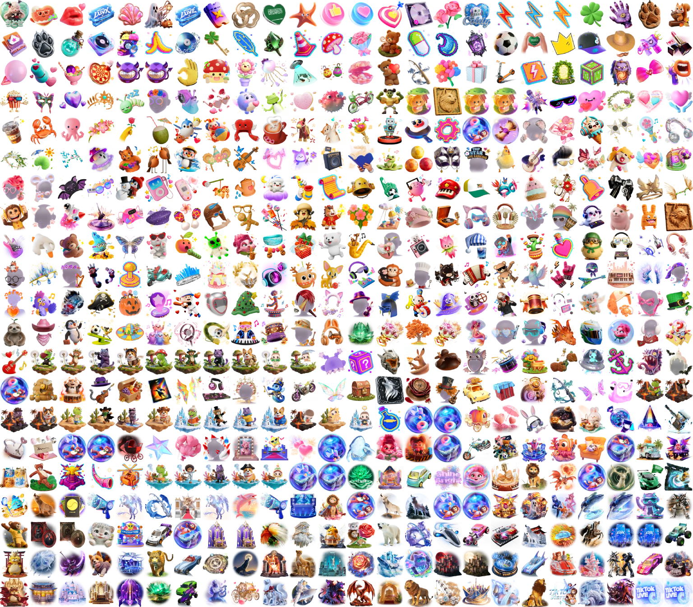

# TikTok LIVE のギフト欄（日本、ログインあり・なしの差）

日本の IP から取得したギフト一覧を、ログインなしとログインありで比べています（配信 https://www.tiktok.com/@ho_zuki_chitose/live（room 7699445236435143445）の一覧）。比較は giftId、ギフト名は `webcast_language=ja-JP` で取得した日本語です（「ギフト名の言語コード」参照）。リストは CSV（`no,giftId,name,coins,imageUrl`）で、CSV と画像はコインの少ない順（同じコインならギフト欄の表示順）、画像は左上から右へ、行ごとです。

## 概要

| 対象 | 取得方法 | API の一覧 | 配信画面に出るギフト | 画像・データ |
| --- | --- | ---: | ---: | --- |
| 配信 https://www.tiktok.com/@ho_zuki_chitose/live（room 7699445236435143445）の一覧 | ログインなし（AWS の API Gateway ap-northeast-1 経由） | 690 | 判別できない（`is_displayed_on_panel` がすべて false） | [画像](live/anonymous.png)・[JSON](live/anonymous.json) |
| 配信 https://www.tiktok.com/@ho_zuki_chitose/live（room 7699445236435143445）の一覧 | ログインあり（セッション Cookie、手元から） | 690 | 186 | [画像](live/signed-in.png)・[JSON](live/signed-in.json) |

配信画面のギフト欄に出るのは、ログインありの一覧で `is_displayed_on_panel` が true のギフトだけです（配信を開いて数えたギフト欄の件数が、その配信を指定したログインありの一覧で true の件数と一致することを確認済み）。ログインなしの一覧には、配信画面に出ないギフトも含まれます。

## 配信 https://www.tiktok.com/@ho_zuki_chitose/live（room 7699445236435143445）の一覧

取得: ログインなし 2026-10-22T11:55:11.382Z、ログインあり 2026-10-22T11:55:11.382Z

### ログインありで配信画面に出るギフト: 186 種類


リスト: [live/shown.csv](live/shown.csv)

### ログインなしの一覧にあり、ログインありでは配信画面に出ないギフト: 504 種類



リスト: [live/hidden.csv](live/hidden.csv)

### ログインありで配信画面に出て、ログインなしの一覧にないギフト: なし

## 取得方法

### ログインなし

TikTok はギフト欄の地域を接続元の IP で決めます。AWS の東京リージョン（ap-northeast-1）に置いた API Gateway（REST API、HTTP プロキシ統合）を経由し、日本の IP からログインせずに問い合わせています。

```
GET <東京リージョンのゲートウェイ>/gift-list?aid=1988&device_platform=web_pc&app_language=ja-JP&webcast_language=ja-JP&room_id=<配信の room（配信を指定するときだけ）>
x-api-key: <API キー>
```

- ゲートウェイは `https://webcast.tiktok.com/webcast/gift/list/` に転送します（クエリとヘッダーはそのまま）
- 配信を指定するときは `room_id` にその配信の room を付けます（その配信を開いたときと同じ一覧）。room はユーザー名から、ゲートウェイの `/user-room`（`https://www.tiktok.com/api-live/user/room/`）で調べます。配信を指定しないときは付けません（特定の配信に依存しない一覧）
- 呼び出しには API キーが必須で、5 リクエスト/秒・1 日 1000 リクエストに制限しています。ゲートウェイの URL と API キーは公開していません
- 構築は AWS CDK（`src/cdk/`）、`AWS_PROFILE=<プロファイル> bun run deploy` でデプロイします

### ログインあり

TikTok にログインしたアカウントのセッション Cookie `sessionid`（32 桁の 16 進数）を付けて、同じ一覧を日本の IP（手元）から問い合わせています。

```
GET https://webcast.tiktok.com/webcast/gift/list/?aid=1988&device_platform=web_pc&app_language=ja-JP&webcast_language=ja-JP&room_id=<配信の room（配信を指定するときだけ）>
Cookie: sessionid=<ログイン済みアカウントのセッション>
```

- ログインありの一覧では、配信画面のギフト欄（下のバーと「More」）に出すギフトだけ `is_displayed_on_panel` が true になります。ログインなしではすべて false です
- セッションは Git 管理外のファイル（`private/tiktok-sessionid.secret`、権限 0600）から環境変数 `TIKTOK_SESSIONID` に読み込みます。値はログ・結果に書かず、AWS にも送りません

## ギフト名の言語コード

ギフト名（`name`）は、ギフト一覧 API のクエリの言語コードで決まります。この取得では次の値を送っています（ログインなし・ありとも同じ）。

| クエリ | 送った値 | ギフト名への影響 |
| --- | --- | --- |
| `webcast_language` | `ja-JP` | ギフト名の言語を決める。省略すると英語になる |
| `app_language` | `ja-JP` | ギフト名には影響しない（`webcast_language` と同じ値をそろえて送っている） |

- 確認例: `webcast_language=ja-JP` では「バラ」「天才」、`en-US` または省略では「Rose」「Genius」。`app_language` だけを変えても名前は変わりません
- どのギフトが一覧に並ぶか（giftId の集合）は言語コードでは変わらず、接続元の IP で決まります。比較は giftId で行うため、言語コードは差分に影響しません
- 値は `src/report/report.ts` の `NAME_LANGUAGE` で定義しています
